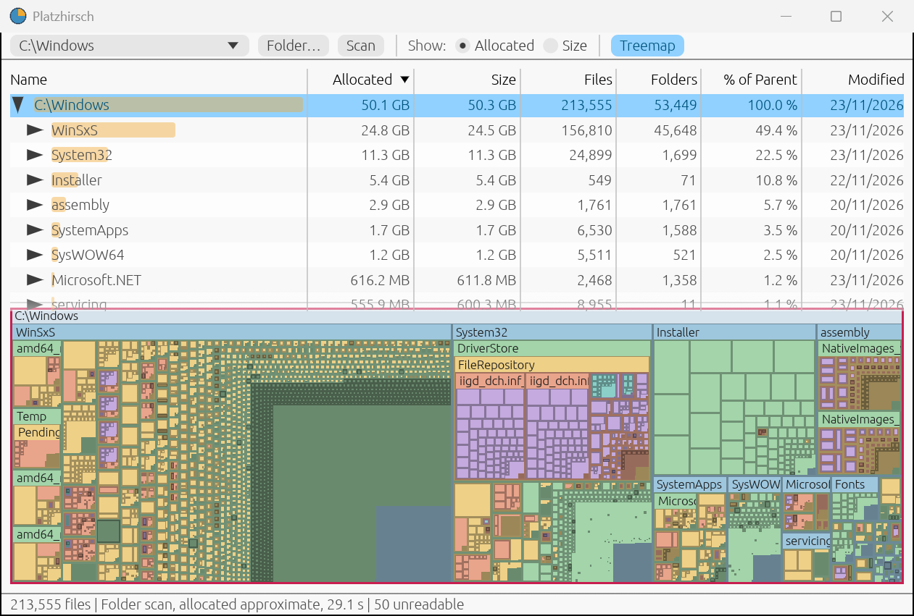

# Platzhirsch

[](https://github.com/lkasdorf/platzhirsch/actions/workflows/ci.yml)

A fast disk space analyzer for Windows. It shows which folders use how much space, as a
folder tree with sizes and as a treemap.

Platzhirsch reads the NTFS Master File Table directly instead of asking Windows for every
folder one by one. On the development machine, a full scan of an NVMe drive with
1.87 million entries takes two to three and a half seconds.



*A folder scan of `C:\Windows` without administrator rights.*

## Download

Version 0.1.0 is the first release. Get `platzhirsch.exe` from the
[releases page](https://github.com/lkasdorf/platzhirsch/releases/latest). It is a single
file: no installer, nothing else to install. Each release lists the SHA-256 checksum of
the file. The executable is not code-signed, so Windows SmartScreen may warn on the first
start.

See the [changelog](CHANGELOG.md) for what each version contains.

## What it does

- **Fast scan** of a whole NTFS drive through the Master File Table. Needs administrator
  rights.
- **Fallback scan** without administrator rights: a parallel folder walk for single
  folders, network paths and drives that are not NTFS.
- **Size and allocated space** per folder, plus file count, folder count and the latest
  modification in the subtree.
- **Honest numbers:** folders that could not be read and online-only cloud folders are
  marked in the table and counted in the status bar, never shown silently as 0 bytes.
  Links (junctions and symbolic links) are marked and never followed.
- **Folder table** with a share bar per entry, sorting by any column, keyboard
  navigation, and "Show in Explorer" / "Copy path" on right-click. Only the visible rows
  are drawn.
- **Treemap** of the folder selected in the table, coloured by level. Hover for path and
  size, click a tile to select it in the table. The divider can be dragged and the
  treemap can be hidden.
- **A single .exe**, no installer, no runtime to install.

## What it never does

- It never writes to the drive it scans. Volumes and folders are opened read-only, and
  file contents are never opened.
- It has no network access: no telemetry, no update check, no advertising.

Guard tests in `tests/anti_goals.rs` back this up. They fail if a call from a list of
write, delete and network functions appears in the source, if a networking feature of the
Windows bindings is enabled, or if a known network library appears among the
dependencies. They are tripwires against an accidental change, not a proof.

## Measured

Taken on 2026-11-21 and 2026-11-22 with the diagnostic program `bench`:

| | Result |
|---|---|
| Fast scan, NVMe drive, 1.87 million entries | 2.1 s and 3.4 s in two runs |
| Deviation of "allocated" from the drive's used space | 0.36 % |
| Memory after the scan | 147 MB |
| Peak memory during the scan | 246 MB |
| Fallback scan of the same drive, without administrator rights | 42 s |

For a folder with 141,418 files, the fast scan and the fallback scan report the same
file count and the same size.

## Build

You need Windows 10 or 11 (x64) and Rust 1.95 or newer with the MSVC target.

```powershell
cargo build --release
```

The program is `target\release\platzhirsch.exe`.

```powershell
cargo test
```

The tests run without administrator rights.

## Use

Start `platzhirsch.exe`, choose a drive or a folder and press "Scan". For a whole NTFS
drive the app offers to restart as administrator for the fast scan, or to scan slowly
without it.

A scan can also be started from the command line:

```powershell
platzhirsch.exe --scan C:
```

The status bar shows the free space of the drive, the number of files, which scan ran and
how long it took. Three counters appear only when they are not zero:

- `skipped`: entries the fast scan could not read or could not place in the tree.
- `unreadable`: folders the fallback scan could not open, usually for lack of rights.
- `online-only`: cloud folders that are not on this machine. They are not entered.

## How it works

- `src/scan/mft.rs` locates the Master File Table on the volume, reads it in large
  chunks and parses the file records in parallel.
- `src/scan/walk.rs` is the fallback: it lists folders in parallel with ordinary Win32
  calls.
- Both fill the same flat in-memory tree in `src/model.rs`, which stores about 53 bytes
  per entry plus the name.
- `src/treemap.rs` computes the squarified treemap layout.
- `src/ui/` is the egui user interface.

The design document and the implementation plan are in
[`docs/superpowers/`](docs/superpowers/).

## Known limits

- The fast scan works on NTFS only. Other file systems use the fallback scan.
- A file with several hard links is counted once and shown under one of its names, so
  folder totals inside `Windows` can differ from tools that count every name.
- In the fallback scan, "allocated" is an approximation and hard links are counted once
  per name.
- Very small files that NTFS stores inside the Master File Table count as 0 allocated,
  and the space folders need for their own index is not counted. This is why the
  allocated total of a drive is slightly below its used space.
- A cloud folder that is not on this machine is refused as a scan target. The check
  looks at every folder on the path to the chosen folder. It stops at the first folder
  whose parent cannot be listed. When the path goes through a link, Windows resolves the
  link before the folders behind it can be checked, so a link that points into an
  online-only folder can still make the provider fetch that folder's entry.
- The drive list is read again each time it is opened, so a drive plugged in later
  appears there.
- The program needs OpenGL 2 or newer. In some virtual machines and remote sessions it
  cannot start and says so.
- The window cannot be read by screen readers.
- The executable is not code-signed, so Windows SmartScreen may warn on the first start.

## License

[MIT](LICENSE)
